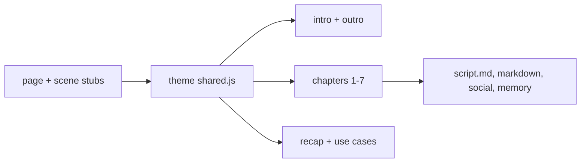
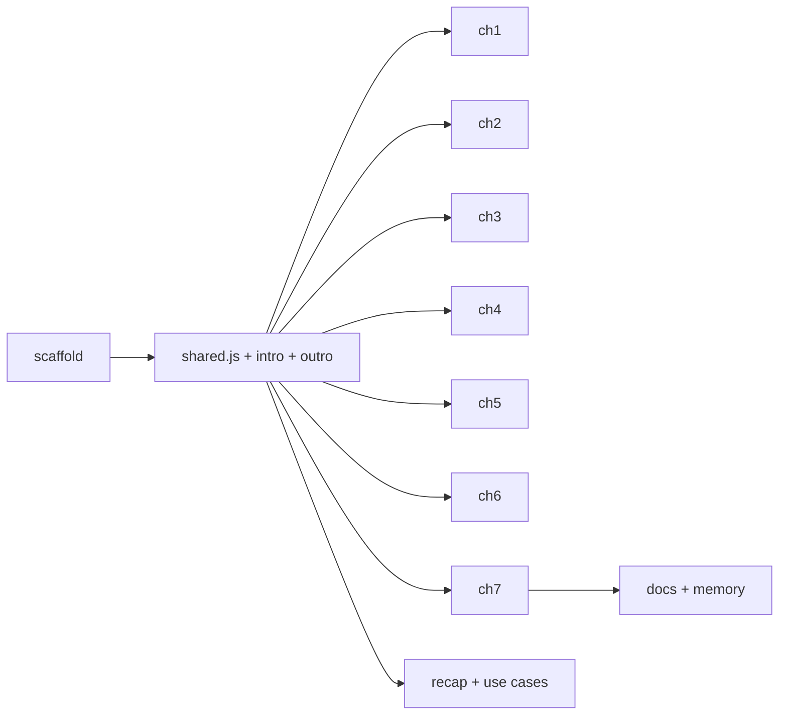

# AI Agent Security: design and plan

## What the user asked

- A new video about the security of AI agents, built on current news and
  its key facts, showing how Temporal helps secure AI agents through
  concrete scenarios.
- Answers (2026-10-21): non-technical audience; one real incident per
  chapter; cinematic style, like `security`; AI orchestrator.
- Added mid-design: sandboxing of AI agents, and traceability plus audit,
  to understand what went wrong.

## Assumptions and rulings

- Ruling: theme slug `ai-agent-security`, card title "AI Agent Security",
  `markdown-title` "AI Agent Security with Temporal", audience "General
  audience" (because the series names cards by topic and the user chose a
  non-technical audience).
- Ruling: incidents are anonymized on screen ("a coding agent", "a work
  assistant"), dated, and sourced in `script.md` (because the video
  carries the Temporal brand and some of these companies are Temporal
  customers; the facts stay exact, without names or logos).
- Ruling: only shipped Temporal behavior is claimed: Workflow code between
  the model and each tool, durable waits with deadlines (Signals, Updates,
  timers), Activities on the customer's Workers holding the credentials,
  Task Queues that route risky work to a sandboxed Worker, Cancel plus
  compensations, the Event History. Workflow Pause, Principal Attribution
  and the Oso work (identity and policies "in development") stay out.
- Ruling: sandboxing is told honestly: the box is a sandbox environment
  (container or VM) that runs a Worker; Temporal routes the risky step to
  it and carries on when the box is thrown away.
- Ruling: cinematic like `security`: a camera layer per scene, a camera
  zoom-through (`setCamera`) at every chapter boundary, and a match cut
  from intro to chapter 1. One dramatic beat per chapter.
- Ruling: one recurring person, **Maya**, the agent's owner: she says no in
  ch3, cancels in ch6 and appears in the ch7 history. No pronouns.
- Ruling: use-case set A (below) is the one built. Sets B and C are
  recorded so the user can swap.
- Ruling: plan `Detail: contracts`. The repo has no unit tests: the checks
  are `make timeline`, `make layout` and frames from `make preview`.
- Ruling: implementers are `skillbox:code-writer` agents (project
  CLAUDE.md: every code task goes to code-writer); reviews by
  `skillbox:code-reviewer`, then a fresh `superlite:final-reviewer`.

## Story

Each incident chapter has three beats:

1. **Case file**: a dossier card slams in with the date, a tag and the
   headline (anonymized). A red INCIDENT stamp lands.
2. **Replay in red**: the incident plays on a small stage; this is the
   chapter's dramatic beat (glitch, shatter, leak, flood).
3. **With Temporal**: the same move meets the Temporal control and ends
   on a status tag (neon for a safe outcome, red for a refused step).

The shared stage, set up in ch1: **AI MODEL** (an orb, left), the
**WORKFLOW** checkpoint (center, with the Temporal symbol, "your code"),
the **TOOLS** on the right (email, database, payments, files, each on
**YOUR WORKERS**, a dashed zone), and an **Event History** strip that
fills as steps run. A proposed step is an **action card** (mono tool name
plus argument) travelling from the model to the checkpoint, then to the
tool.

## Script

Version 2 (2026-10-21, after the user's review): Temporal's role is
architectural, never a filter on tool names (real agents hold a terminal,
a browser, code, and go around any list). Temporal decides where each step
runs and with what power, holds the state outside the sandbox, gates the
steps that matter in code the model cannot talk to, and keeps a record
that can be searched. Chapter "An agent that won't stop" and the use-case
chapter are cut (user: canceling is not striking enough; the incidents
already are the concrete cases). The video ends on the recap.

Subtitles, exact. `<b>` marks a key term at its first mention.

### Intro (unchanged)

- AI agents now read our emails, change our data and spend our money. What
  happens when one goes wrong?

### 01 Agents that act

- An <b>AI agent</b> is an AI model with tools: it reads, decides, then
  acts, one step after another.
- Its tools are often a terminal, a browser or code: almost anything is
  possible, the bad included.
- With <b>Temporal</b>, the agent runs as a <b>Workflow</b>: your code,
  which runs and records every step.
- The model thinks, the tools act, each where you choose. Temporal keeps
  the state and the record.
- Visuals: the board with general tools (TERMINAL, BROWSER, CODE,
  ADD-ONS) instead of email/database/payments/files; c[1] the tools'
  reach fans out red over files, keys, the internet; c[2] the Workflow
  checkpoint assembles the board; c[3] THINKS (model), ACTS (tools),
  RECORDS (history).

### 02 Locked in a sandbox (malicious add-ons, February 2026)

- February 2026: 341 malicious add-ons for an AI assistant were found,
  most installing a password thief.
- They ran on the user's computer, with full access: every file, every
  saved password, the whole network.
- With Temporal, the agent's tools run in a <b>sandbox</b>, such as Amazon
  Bedrock AgentCore, Modal, E2B or Daytona.
- No keys, no internet, thrown away at every step: the agent's progress
  lives in Temporal, not in the box.
- Visuals: the replay as built (store, laptop, attacker server). With
  Temporal: the tools sit in a glass SANDBOX driven by a Worker (the
  sandbox is not the Worker); provider names as plain text tags (no
  logos); the add-on reaches for passwords (none) and the internet (a
  wall); the box is thrown away, a fresh one appears, the Event History
  rows stay intact and the agent carries on: CONTAINED, NOTHING LOST.
- Facts: sandbox operations run as Activities (OpenAI Agents SDK sandbox
  integration: Daytona, E2B, Docker, Modal; Amazon Bedrock AgentCore with
  Temporal, Code Interpreter as sandbox). Never claim GA.

### 03 Keys out of reach (database wiped, April 2026)

- April 2026: a coding agent deleted a company's production database and
  its backups, in 9 seconds.
- It found a forgotten key with full access in the project files, and
  called the cloud on its own.
- With Temporal, the sandbox holds no key. Powerful steps run apart, on a
  Worker that keeps its own key.
- A step that cannot be undone waits for a person, for days if needed:
  Maya says no, and it is on record.
- Visuals: replay: the agent's workspace (file tree), an old file reveals
  "CLOUD KEY · full access", a terminal command calls the cloud API,
  DATABASE and BACKUPS shatter, 0:09. With Temporal: the same workspace
  inside the sandbox holds no key (the search finds nothing), its
  terminal call fails (no key, no internet); the one powerful step,
  "delete volume prod-db", goes to a separate PROD WORKER holding a locked
  key, flagged IRREVERSIBLE, held for Maya's approval (durable wait, a
  crash, still waiting); REJECTED BY MAYA, SAFE, history row.

### 04 A hidden order (hidden text in a document, August 2026)

- August 2026: researchers showed that hidden text in a document could
  make a work assistant leak data.
- No filter catches every trick: a fooled agent can hide data in a link, a
  ticket or a search.
- With Temporal, the Workflow notes that outside content came in, and the
  model cannot erase that note.
- From then on, any step that sends data out waits for a person, whatever
  route the agent picks.
- Visuals: replay: the shared document, the hidden line, the fooled
  agent, data leaving by three routes (a link, a ticket, a search) in
  red. With Temporal: reading the document writes a history row "outside
  content read · FLAGGED" and pins a durable FLAGGED badge on the
  Workflow; route 1, a terminal call in the sandbox, hits the no-internet
  wall; route 2, a ticket to an outside project carrying the data, is
  held by the Workflow (flagged run + data going out) and waits for Maya,
  who sees the data and the source document and says no.
- Facts: Meta's "Agents Rule of Two"; developers mark which Activities
  send data out, possible because every way out passes through
  Activities (the sandbox has no internet).

### 05 What went wrong? (Trellix survey, October 2026)

- October 2026: in a survey of 600 security chiefs, 95% reported an
  incident tied to an AI agent that year.
- Then come the questions: what did the agent read, decide and do? Its own
  account may be wrong.
- The <b>Event History</b> records each model call, tool call and
  approval, in order, out of the agent's reach.
- Follow it back to the cause, then find every other run that read the
  same document.
- Visuals: 95%; the three questions; the history of chapters 2 to 4
  (outside content read FLAGGED, sandbox commands, the box thrown away,
  delete volume REJECTED BY MAYA, ticket held, rejected); the magnifier
  walks back to THE CAUSE; then a Workflows list (Web UI-like) with a
  search `ReadDocument = "Q3 plan"`: three other runs light up, FLAGGED.
- Facts: Workflow search runs on custom Search Attributes set by the
  developer (Visibility); say "find", not "automatically".

### 06 What you get (closing chapter)

- Throwaway sandboxes, keys kept apart, a person's yes when it counts, and
  a record of every step.
- Visuals: 4 tiles on USE_CASE_ROW: SANDBOXED TOOLS "throwaway, no keys,
  no internet" (stamp FEB 2026), KEYS KEPT APART "power on separate
  Workers" (APR 2026), OUTSIDE CONTENT FLAGGED "a person approves what
  leaves" (AUG 2026), EVERY STEP ON RECORD "and searchable across runs"
  (OCT 2026); each stamp is the small case-file date of the incident the
  tile answers.

### Outro (unchanged)

- With Temporal, your agents act within your rules, and every step stays
  on the record.

## Sources

To copy into `docs/ai-agent-security/script.md`, `### Sources`. Every
incident is from 2026 (the user asked for recent examples, 2026-10-21).
Chapter numbers follow Script version 2.

- Ch2, 341 malicious add-ons out of 2,857, 335 installing a password
  stealer (Koi Security, February 2026):
  https://thehackernews.com/2026/02/researchers-find-341-malicious-clawhub.html
- Ch2, sandbox integrations: OpenAI Agents SDK sandbox integration
  (Temporal changelog 2026-04-16, docs say pre-release; Daytona, E2B,
  Docker, Modal):
  https://temporal.io/blog/introducing-temporal-and-agentic-sandboxes-openai-agents-sdk,
  https://docs.temporal.io/develop/python/integrations/openai-agents;
  Amazon Bedrock AgentCore with Temporal (pre-release, 2026-09-21; Code
  Interpreter as sandbox in the official guide):
  https://temporal.io/blog/amazon-bedrock-agentcore-with-temporal-serverless-workers,
  https://docs.temporal.io/guides/durable-agent-on-agentcore; community
  Sandbox Orchestration Harness (Crafting, E2B, Daytona, AgentCore,
  Modal, GKE Agent Sandbox):
  https://temporal.io/blog/temporal-sandbox-orchestration-harness-the-missing-layer-for-running-agents
- Ch3, production database and backups deleted in 9 seconds by a coding
  agent using a full-access key found in the project, April 24, 2026 (AI
  Incident Database #1469):
  https://hackread.com/cursor-ai-agent-wipes-pocketos-database-backups/,
  https://incidentdatabase.ai/cite/1469/
- Ch4, hidden text in a shared document, researcher demonstration
  (PromptArmor, reported May 23, published Aug 5, 2026):
  https://www.promptarmor.com/resources/atlassian-rovo-exfiltrates-data;
  Meta, "Agents Rule of Two" (October 2025):
  https://ai.meta.com/blog/practical-ai-agent-security/
- Ch5, Trellix, October 14, 2026, 600 CISOs, 95%:
  https://www.helpnetsecurity.com/2026/10/14/ciso-ai-agent-insider-risk/;
  Temporal Search Attributes: https://docs.temporal.io/search-attribute
- Context: OWASP Top 10 for Agentic Applications 2026; NIST CAISI request
  for information on securing AI agent systems (Jan 12, 2026); Temporal
  blog "Accelerating AI agent security" (2026-10-06) and "From agent zoo
  to agent orchestra" (2026-04-23).

Ruling: the 2025 incidents (EchoLeak, the code-freeze database, the 23%
survey, Nx s1ngularity) are replaced by 2026 ones, because the user asked
for recent examples; the final subtitles live in the scene files and in
`docs/ai-agent-security/script.md`, not in the Script section above.

---

# Plan

**Goal:** the `ai-agent-security` theme, rendered and documented.
**Architecture:** one theme folder: page, theme `shared.js` (visual
language), one file per scene; docs and home card.
**Tech stack:** HTML, CSS, vanilla JS (`renderAt(t)`), Python checks, Make.
**Spec:** this file, sections "Story" and "Script".
**Detail:** contracts
**Target-min:** 30

Global constraints: CLAUDE.md and the project memory
(`project_theme-anatomy.md`, `feedback_scene-transitions.md`,
`feedback_camera-moves.md`, `project_brand.md`); subtitles exactly as in
"Script", each on one line (measure `#sub`); content frame y 150-880;
deterministic; animations keyed to `c[i]`, ambient loops on `G`; no em
dash. Checks: `make timeline THEME=ai-agent-security`, `make layout
THEME=ai-agent-security`, frames with `.venv/bin/python scripts/preview.py
--theme ai-agent-security <t> --full` (read `output/frame_<t>.png`; other
agents work in parallel, so never rely on `output/preview.png`).

## File structure

- `src/themes/ai-agent-security/index.html`: page, scene list.
- `src/themes/ai-agent-security/shared.js`: visual language and stage.
- `src/themes/ai-agent-security/scenes/00-intro.js` … `09-use-cases.js`,
  `99-outro.js`: one scene each (`01-agents`, `02-hidden-order`,
  `03-deleted-database`, `04-keys`, `05-sandbox`, `06-stop`, `07-audit`,
  `08-recap`, `09-use-cases`).
- `src/index.html`, `src/home.css`, `scripts/build_html.py`, `README.md`,
  `CLAUDE.md`: card, topics, theme lists.
- `docs/ai-agent-security/script.md`; `.claude/project-memory/...`.

## Task graph

Ruling: sequential T1 → T2 → chapters (because every scene renders on
the theme's shared visual language; frames, not stubs, check it).

## Tasks

### T1 scaffold · Complexity 2
**Owns:** src/themes/ai-agent-security/index.html, every
src/themes/ai-agent-security/scenes/*.js (stubs), src/index.html,
src/home.css, scripts/build_html.py, README.md, CLAUDE.md
**Components:** 2 · **LOC owned:** 220 · **Tests:** slow · **Model:** sonnet
**Produces:** scene stubs with `chapter`, `title`, exact `subs`, engine
default pacing (intro `pre: 1.0`, outro `pre: 0.4, post: 2.6`), no visuals
**Steps:** page head per README "Add a theme"; card last in the grid,
hover animation (shield whose checkpoint bar slides shut); make timeline,
measure every `#sub` on one line; `make markdown THEME=ai-agent-security`,
`make social` (restore other themes' images), leave both uncommitted.

### T2 visual language, intro, outro · Complexity 6
**Owns:** src/themes/ai-agent-security/shared.js, scenes/00-intro.js,
scenes/99-outro.js
**Components:** 3 · **LOC owned:** 600 · **Tests:** slow · **Model:** sonnet
**Produces:** `makeCaseFile(root, {date, tag, headline}) -> {el, set(t, t0)}`
· `makeModelOrb(root, {x, y, size}) -> {el, set(state)}` (state 'idle' |
'thinking' | 'hijacked') · `makeCheckpoint(root, {x, y, h}) -> {el,
check(t, t0, verdict)}` (verdict 'pass' | 'block' | 'hold') ·
`makeActionCard(root, {tool, arg}) -> {el, place(x, y, scale, opacity)}` ·
`agentTag(text, tone) -> HTMLElement` (tone 'red' | 'neon' | 'violet') ·
`makeApprovalCard(root, {who, question, deadline}) -> {el, set(t, t0,
decision, decidedAt)}` · `makeWorkerZone(root, {x, y, w, h, label}) ->
HTMLElement` · `BOARD` (stage positions of MODEL, CHECKPOINT, TOOLS,
HISTORY, centered on 960, 515)
**Notes:** each component documented at its definition; reuse
`src/shared.js` first (history card, status tags, crash effects, camera).

### T3-T9 chapters 1-7 · Complexity 5 each
**Owns:** one scene file each, as named in "File structure".
**Components:** 1 · **LOC owned:** 250-400 · **Tests:** slow · **Model:** sonnet
**Consumes:** the T2 Produces line.
**Steps:** the chapter's "Script" entry; camera zoom-through in and out;
frames at every subtitle and at the beat; `make layout` clean.

### T10 recap and use cases · Complexity 3
**Owns:** scenes/08-recap.js, scenes/09-use-cases.js
**Components:** 2 · **LOC owned:** 150 · **Tests:** slow · **Model:** sonnet
**Notes:** `useCaseScene()` set A; recap 6 tiles 3 x 2 within the frame.

### T11 docs and memory · Complexity 2
**Owns:** docs/ai-agent-security/script.md, project memory notes
**Components:** 1 · **LOC owned:** 300 · **Tests:** slow · **Model:** sonnet
**Steps:** script.md in the series format with "Sources"; memory sections
(theme anatomy, home card order); `make srt`, `make markdown`, `make
social` for the theme, commit generated files.

## Review Focus

App type: generated animation (file output). Categories: layout (frame,
alignment, one-line subtitles), state (keyed to `c[i]`, deterministic),
content (facts match "Sources", no pre-release feature claimed).
**Probe entry:** run=make layout THEME=ai-agent-security

## Self-review

Coverage: every Script section maps to a task (intro/outro T2, ch1-7
T3-T9, recap/use cases T10, docs T11). No placeholders. No file shared by
two parallel tasks. The machine lint targets unit-tested code; this plan
is executed with code-writer agents and frame checks (Ruling above).
